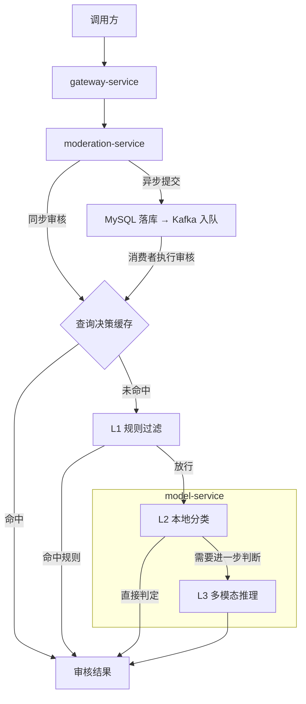

# MultiModel SafetyRisk

一个基于 Java 21、Spring Boot 和 Spring Cloud Gateway 的多模态内容审核后端，支持文本、图片和图文混合内容。调用方可以同步获取 `PASS`、`REVIEW` 或 `REJECT`，也可以提交异步任务并查询最终结果。

## 审核流程



- **L1** 通过用户黑名单、Aho–Corasick 敏感词匹配和正则规则拦截请求。**L2** 可用 ONNX Runtime 执行本地分类。**L3** 默认先调用阿里云百炼，主路由不可用时切换到 OpenAI 兼容的本地服务（如 Ollama 或 vLLM）。两路均不可用时返回 `REVIEW`。
- **同步与异步审核**复用同一流程和 Caffeine + Redis 两级缓存。异步任务用 MySQL 保存状态，通过 Kafka 消费，支持请求去重、失败重试、死信队列及失败任务回放。
- **网关**提供 IP 限流和 `X-Request-Id` 透传。服务通过 Micrometer 暴露指标，由 Prometheus 抓取、Grafana 展示，并将链路追踪数据发往 Zipkin。

## 快速开始

准备 JDK 21、Maven、Bash 和正在运行的 Docker（含 `docker compose`）。在仓库根目录执行以下命令。脚本在宿主机启动 Java 服务，并通过 Docker Compose 启动 MySQL、Redis、Kafka 和监控组件。

```bash
cp -n infra/docker/.env.example infra/docker/.env
MODEL_L3_PROVIDER=mock MODEL_L2_IMAGE_ENABLED=false ./scripts/dev-local.sh start
```

这组配置使用内置的 L3 Mock，适合在没有 API Key 和模型权重的环境中验证接口。Mock 基于关键词生成模拟决策。启动后可用 `./scripts/dev-local.sh status` 查看进程，用 `./scripts/dev-local.sh logs gateway-service` 查看网关日志。

### 同步审核

```bash
curl -fsS http://localhost:8080/api/v1/moderation/check \
  -H 'Content-Type: application/json' \
  -d '{"contentType":"TEXT","content":"这是一条普通的项目动态","userId":"demo-user"}'
```

正常情况下，这条样例在 Mock 模式下返回 `decision: PASS`。响应还包含 `requestId`、`violation`、`confidence` 和 `reason`。

### 异步审核

```bash
curl -fsS http://localhost:8080/api/v1/moderation/check/async \
  -H 'Content-Type: application/json' \
  -d '{"contentType":"TEXT","content":"这是一条异步审核示例","userId":"demo-user"}'

# 使用提交响应中的 taskId 查询任务
TASK_ID='替换为返回的 taskId'
curl -fsS "http://localhost:8080/api/v1/moderation/tasks/${TASK_ID}"
```

任务完成后，查询接口返回 `COMPLETED` 和最终决策。体验结束后，运行 `./scripts/dev-local.sh stop-all` 停止本地进程和依赖容器。

### 接入实际模型

在 `infra/docker/.env` 中设置 `MODEL_L3_PROVIDER`，再使用 `./scripts/dev-local.sh start` 启动。已运行的服务可用 `./scripts/dev-local.sh restart` 重新加载配置。

| L3 配置 | 所需参数 |
| --- | --- |
| `failover`（默认） | 同时配置 `bailian` 和 `vllm` 所需的参数 |
| `bailian` | 设置 `DASHSCOPE_API_KEY` 和 `MODEL_L3_BAILIAN_MODEL` |
| `vllm` | 设置 `MODEL_L3_VLLM_BASE_URL` 和 `MODEL_L3_VLLM_MODEL`，支持 Ollama 等 OpenAI 兼容服务 |
| `mock` | 使用内置模拟实现 |

使用 L2 图像分类时，将微调后的 ResNet50 ONNX 权重放入 `models/resnet50_finetune_onnx/`。以宿主机方式启动时，将 `MODEL_L2_IMAGE_MODEL_PATH` 设为该目录的绝对路径，并启用 `MODEL_L2_IMAGE_ENABLED=true`。L2 文本分类默认使用关键词策略，文本 ONNX 分类头尚未用风控数据微调。容器启动方式和超时配置见 [Docker Compose 文档](infra/docker/README.md)。

## API 概览

网关默认监听 `http://localhost:8080`。

| 方法 | 路径 | 用途 |
| --- | --- | --- |
| `POST` | `/api/v1/moderation/check` | 同步审核 JSON 请求 |
| `POST` | `/api/v1/moderation/check/upload` | 通过 multipart 上传图片进行同步审核 |
| `POST` | `/api/v1/moderation/check/async` | 提交异步审核任务 |
| `GET` | `/api/v1/moderation/tasks/{taskId}` | 查询任务状态与审核结果 |
| `POST` | `/api/v1/moderation/tasks/{taskId}/replay` | 回放单个失败任务 |
| `POST` | `/api/v1/moderation/tasks/replay/batch` | 批量回放失败任务 |

JSON 请求的 `contentType` 支持 `TEXT`、`IMAGE` 和 `MIXED`。图片可以通过 `imageUrl` 传入 HTTP(S) 地址，也可以通过 `imageData` 传入 Base64 或 data URL。字段定义与内部评测接口见 [API 文档](API文档.md)。

## 项目结构

| 路径 | 职责 |
| --- | --- |
| `gateway-service/` | 路由、请求标识、IP 限流 |
| `moderation-service/` | 审核编排、L1 规则、决策缓存、异步任务 |
| `model-service/` | L2 ONNX 推理、L3 路由与故障转移 |
| `common-core/` | 跨服务共享的请求和响应模型 |
| `mock-bailian-service/` | 模拟百炼接口，复现限流、服务错误和慢响应 |
| `infra/docker/` | Docker Compose、监控配置及数据库迁移 |
| `scripts/` | 本地启动、压测与评测脚本 |

## 测试与评测

- `mvn test` 运行 Maven 多模块测试。
- [JMeter 压测](scripts/jmeter/README.md)覆盖同步审核和异步提交、轮询流程。
- [评测脚本](scripts/eval/README.md)支持 L2、L3 和完整链路的独立评测，汇总准确率、Macro-F1、混淆矩阵及延迟。
